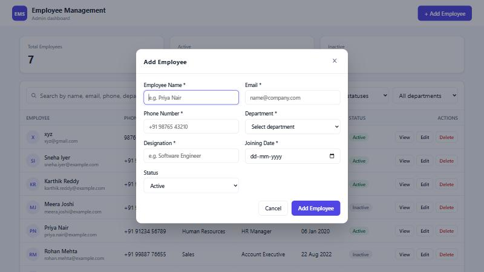
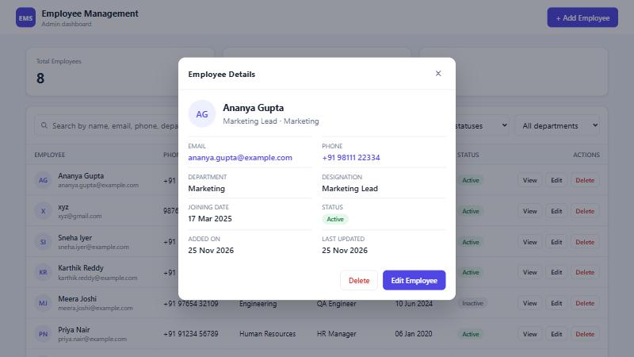

# Employee Management System (MERN)

A basic Employee Management System where an admin can create, view, search, filter, update and delete employee records from a responsive dashboard.

**Stack:** MongoDB · Express.js · React.js (Vite) · Node.js. Frontend and backend live in **one project** with one `package.json`.


## Features

**Frontend (React + Vite)**
- Responsive dashboard with summary cards (total / active / inactive)
- Employee table; collapses into cards on mobile
- Add / edit employee form in a modal, with client-side validation and server error messages shown per field
- Search by name, email, phone, department or designation (debounced)
- Status filter (All / Active / Inactive) and department filter
- Employee details view
- Delete with confirmation
- Loading spinners, empty states, API error banner with retry, and toast notifications

**Backend (Node + Express + Mongoose)**
- REST API for CRUD on employees
- Request validation (required fields, email and phone format, valid date, status enum) returning `400` with per-field errors
- Central error handler: invalid ObjectId → `400`, not found → `404`, duplicate email → `409`, malformed JSON → `400`, database unavailable → `503`, unknown route → `404`
- Server-side search and filters via query parameters

## Project Structure

```
BMDU-task/
├── api/index.js              # Vercel serverless entry → backend/app.js
├── backend/                  # Express REST API
│   ├── config/db.js          # MongoDB connection (cached; optional in-memory DB)
│   ├── models/Employee.js    # Mongoose schema
│   ├── validators/           # Request payload validation
│   ├── controllers/          # Route handlers
│   ├── routes/               # /api/employees routes
│   ├── middleware/           # 404 + error handler
│   ├── seed.js               # Sample data
│   ├── app.js                # Express app (exported)
│   └── server.js             # Local entry point (app.listen)
├── src/                      # React dashboard
│   ├── api/employees.js      # API client
│   ├── components/           # Table, Form, Details, Modal, Toast
│   ├── App.jsx
│   └── index.css
├── scripts/smoke-test.js     # End-to-end CRUD API test
├── index.html
├── vite.config.mjs           # Dev proxy /api → http://localhost:5000
├── vercel.json
├── package.json
└── .env.example
```

## Employee Schema

| Field         | Type   | Rules                                            |
|---------------|--------|--------------------------------------------------|
| `name`        | String | required, 2–100 chars                            |
| `email`       | String | required, valid email, unique, stored lowercase  |
| `phone`       | String | required, 7–15 digits (`+`, spaces, `-` allowed) |
| `department`  | String | required                                         |
| `designation` | String | required                                         |
| `joiningDate` | Date   | required, valid date                             |
| `status`      | String | `Active` or `Inactive` (default `Active`)        |

`createdAt` / `updatedAt` timestamps are added automatically.

## Setup

### Prerequisites
- Node.js 18+
- MongoDB running locally **or** a MongoDB Atlas connection string.
  No MongoDB? Use the in-memory option below.

### Install and run

```bash
npm install
cp .env.example .env        # Windows: copy .env.example .env
# edit MONGO_URI in .env
npm run seed                # optional: insert sample employees
npm run dev                 # API on :5000 + UI on http://localhost:5173
```

**No MongoDB installed?** Run against an in-memory MongoDB (sample data is seeded automatically, data resets on restart, the first run downloads a MongoDB binary):

```bash
npm run dev:memory
```

> Windows PowerShell blocking `npm` ("running scripts is disabled")? Use `npm.cmd run dev`, or run
> `Set-ExecutionPolicy -Scope CurrentUser RemoteSigned` once.

### Production build on one port

```bash
npm run build               # builds the React app into dist/
npm start                   # Express serves dist/ and /api on http://localhost:5000
```

Useful for sharing locally with a tunnel, e.g. `ngrok http 5000`.

### Scripts

| Script               | What it does                                      |
|----------------------|---------------------------------------------------|
| `npm run dev`        | API (watch mode) + Vite dev server together       |
| `npm run dev:memory` | Same, using the in-memory MongoDB                 |
| `npm run build`      | Build the React app into `dist/`                  |
| `npm start`          | Run Express (serves `dist/` if built)             |
| `npm run seed`       | Insert sample employees if the collection is empty |
| `npm run test:api`   | CRUD smoke test against a running API             |

### Environment variables (`.env`)

| Variable         | Default                                          |
|------------------|--------------------------------------------------|
| `PORT`           | `5000`                                           |
| `MONGO_URI`      | `mongodb://127.0.0.1:27017/employee_management`  |
| `CLIENT_ORIGIN`  | `http://localhost:5173` (CORS, comma-separated)  |
| `USE_MEMORY_DB`  | `false`                                          |
| `VITE_API_URL`   | empty (UI calls `/api` on the same domain)       |

### Test the API

With the API running:

```bash
npm run test:api
```

This runs create, duplicate-email, invalid-payload, list, search/filter, update, invalid-update, invalid-id, delete and 404 checks against the live API.

## Deploy to Vercel

The project deploys as a **single Vercel project**: Vite builds the UI into `dist/`, and `api/index.js` runs the Express app as a serverless function for every `/api/*` request (see [`vercel.json`](vercel.json)).

1. Create a free MongoDB Atlas cluster, add a database user, and under **Network Access** allow `0.0.0.0/0` (Vercel has no fixed IPs).
2. In Vercel, **Add New → Project**, import the repo, keep Root Directory `./`. The preset is picked up from `vercel.json` (Vite).
3. Add the environment variable `MONGO_URI` = your Atlas connection string, e.g. `mongodb+srv://<user>:<password>@<cluster>.mongodb.net/employee_management`.
4. Deploy. To load sample data, put the same `MONGO_URI` in your local `.env` and run `npm run seed`.

The in-memory database is for local use only and does not work on Vercel.

## API Reference

Base URL: `http://localhost:5000/api` (or `https://<your-app>.vercel.app/api`)

| Method | Endpoint           | Description                                      |
|--------|--------------------|--------------------------------------------------|
| GET    | `/health`          | Health and DB connection status                  |
| GET    | `/employees`       | List employees. Query: `search`, `status`, `department` |
| GET    | `/employees/:id`   | Get one employee                                 |
| POST   | `/employees`       | Create employee                                  |
| PUT    | `/employees/:id`   | Update employee (partial updates allowed)        |
| DELETE | `/employees/:id`   | Delete employee                                  |

**Create request**

```json
POST /api/employees
{
  "name": "Priya Nair",
  "email": "priya.nair@example.com",
  "phone": "+91 91234 56789",
  "department": "Human Resources",
  "designation": "HR Manager",
  "joiningDate": "2020-01-06",
  "status": "Active"
}
```

**List response**

```json
{
  "success": true,
  "count": 1,
  "stats": { "total": 6, "active": 4, "inactive": 2 },
  "data": [ { "_id": "...", "name": "Priya Nair", "...": "..." } ]
}
```

**Validation error (400)**

```json
{
  "success": false,
  "message": "Validation failed",
  "errors": { "email": "Email is invalid", "department": "Department is required" }
}
```

## Screenshots

| Dashboard | Add Employee |
|-----------|--------------|
|  |  |

| Employee Details | Mobile |
|------------------|--------|
|  |  |
