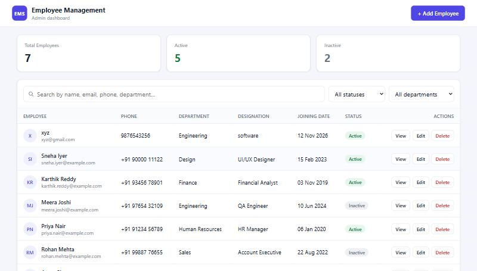
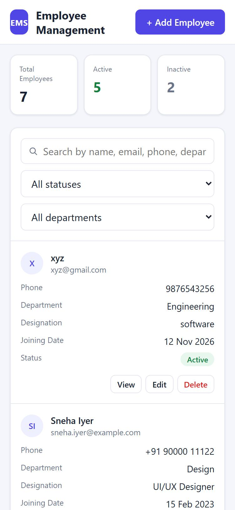

# Employee Management System (MERN)

A basic Employee Management System where an admin can create, view, search, filter, update and delete employee records from a responsive dashboard.

**Stack:** MongoDB · Express.js · React.js (Vite) · Node.js



## Features

**Frontend (React + Vite)**
- Responsive dashboard with summary cards (total / active / inactive)
- Employee table; collapses into cards on mobile
- Add / edit employee form in a modal, with client-side validation and server error messages shown per field
- Search by name, email, phone, department or designation (debounced)
- Status filter (All / Active / Inactive) and department filter
- Employee details view
- Delete with confirmation
- Loading spinners, empty states, API error banner with retry, and toast notifications

**Backend (Node + Express + Mongoose)**
- REST API for CRUD on employees
- Request validation (required fields, email and phone format, valid date, status enum) returning `400` with per-field errors
- Central error handler: invalid ObjectId → `400`, not found → `404`, duplicate email → `409`, malformed JSON → `400`, unknown route → `404`
- Server-side search and filters via query parameters

## Project Structure

```
BMDU-task/
├── server/                     # Express REST API
│   ├── src/
│   │   ├── config/db.js        # MongoDB connection (or in-memory DB)
│   │   ├── models/Employee.js  # Mongoose schema
│   │   ├── validators/         # Request payload validation
│   │   ├── controllers/        # Route handlers
│   │   ├── routes/             # /api/employees routes
│   │   ├── middleware/         # 404 + error handler
│   │   ├── seed.js             # Sample data
│   │   ├── app.js              # Express app
│   │   └── server.js           # Entry point
│   └── scripts/smoke-test.js   # End-to-end CRUD API test
└── client/                     # React dashboard (Vite)
    └── src/
        ├── api/employees.js    # API client
        ├── components/         # Table, Form, Details, Modal, Toast
        ├── App.jsx
        └── index.css
```

## Employee Schema

| Field         | Type   | Rules                                            |
|---------------|--------|--------------------------------------------------|
| `name`        | String | required, 2–100 chars                            |
| `email`       | String | required, valid email, unique, stored lowercase  |
| `phone`       | String | required, 7–15 digits (`+`, spaces, `-` allowed) |
| `department`  | String | required                                         |
| `designation` | String | required                                         |
| `joiningDate` | Date   | required, valid date                             |
| `status`      | String | `Active` or `Inactive` (default `Active`)        |

`createdAt` / `updatedAt` timestamps are added automatically.

## Setup

### Prerequisites
- Node.js 18+ (uses built-in `fetch`)
- MongoDB running locally **or** a MongoDB Atlas connection string.
  No MongoDB? Use the in-memory option below.

### 1. Backend

```bash
cd server
npm install
cp .env.example .env        # Windows: copy .env.example .env
# edit MONGO_URI in .env if needed
npm run seed                # optional: insert sample employees
npm run dev                 # http://localhost:5000
```

**No MongoDB installed?** Run against an in-memory MongoDB (sample data is seeded automatically; data resets on restart; the first run downloads a MongoDB binary):

```bash
npm run dev:memory
```

`.env` variables:

| Variable         | Default                                          |
|------------------|--------------------------------------------------|
| `PORT`           | `5000`                                           |
| `MONGO_URI`      | `mongodb://127.0.0.1:27017/employee_management`  |
| `CLIENT_ORIGIN`  | `http://localhost:5173` (CORS, comma-separated)  |
| `USE_MEMORY_DB`  | `false`                                          |

### 2. Frontend

```bash
cd client
npm install
npm run dev                 # http://localhost:5173
```

In development, Vite proxies `/api` to `http://localhost:5000`. For a production build, set `VITE_API_URL` (see `client/.env.example`) and run `npm run build`.

### 3. Test the API

With the server running:

```bash
cd server
npm run test:api
```

This runs create, duplicate-email, invalid-payload, list, search/filter, update, invalid-update, invalid-id, delete and 404 checks against the live API.

## API Reference

Base URL: `http://localhost:5000/api`

| Method | Endpoint           | Description                                      |
|--------|--------------------|--------------------------------------------------|
| GET    | `/health`          | Health and DB connection status                  |
| GET    | `/employees`       | List employees. Query: `search`, `status`, `department` |
| GET    | `/employees/:id`   | Get one employee                                 |
| POST   | `/employees`       | Create employee                                  |
| PUT    | `/employees/:id`   | Update employee (partial updates allowed)        |
| DELETE | `/employees/:id`   | Delete employee                                  |

**Create request**

```json
POST /api/employees
{
  "name": "Priya Nair",
  "email": "priya.nair@example.com",
  "phone": "+91 91234 56789",
  "department": "Human Resources",
  "designation": "HR Manager",
  "joiningDate": "2020-01-06",
  "status": "Active"
}
```

**List response**

```json
{
  "success": true,
  "count": 1,
  "stats": { "total": 6, "active": 4, "inactive": 2 },
  "data": [ { "_id": "...", "name": "Priya Nair", "...": "..." } ]
}
```

**Validation error (400)**

```json
{
  "success": false,
  "message": "Validation failed",
  "errors": { "email": "Email is invalid", "department": "Department is required" }
}
```

## Screenshots

| Dashboard | Add Employee |
|-----------|--------------|
|  |  |

| Employee Details | Mobile |
|------------------|--------|
|  |  |

## Deploy to Vercel

The repo deploys as one Vercel project with two [services](https://vercel.com/docs/services) (see [`vercel.json`](vercel.json)):

| Service  | Folder    | Public path | What it is                                  |
|----------|-----------|-------------|---------------------------------------------|
| `client` | `client/` | `/*`        | React (Vite) static build                   |
| `server` | `server/` | `/api/*`    | Express API (`src/app.js`) as a serverless function |

The browser calls the API on the same domain (`/api/...`), so no CORS setup or service bindings are needed.

1. Create a free MongoDB Atlas cluster, add a database user, and under **Network Access** allow `0.0.0.0/0` (Vercel has no fixed IPs).
2. Import the GitHub repo in Vercel (**Add New → Project**) and leave the root directory as the repo root.
3. Add the environment variable `MONGO_URI` = your Atlas connection string (e.g. `mongodb+srv://<user>:<password>@<cluster>.mongodb.net/employee_management`).
4. Deploy. Optionally seed sample data once from your machine: put the same `MONGO_URI` in `server/.env` and run `npm run seed`.

The in-memory database (`npm run dev:memory`) is for local use only and does not work on Vercel.
